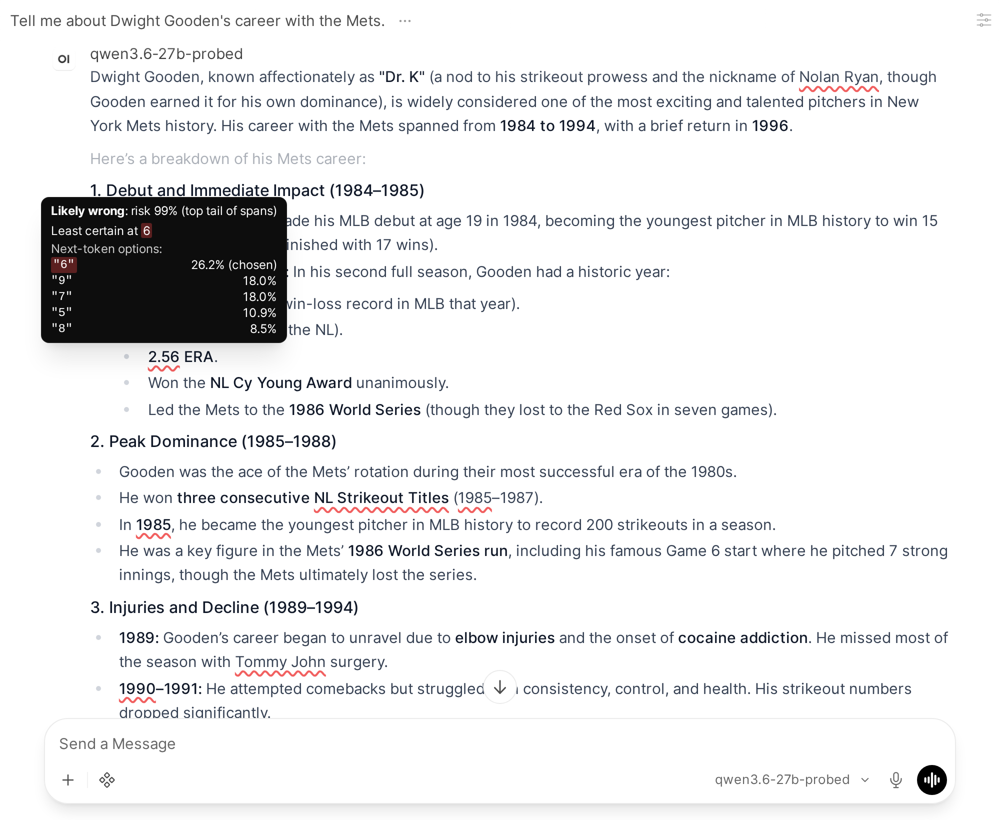
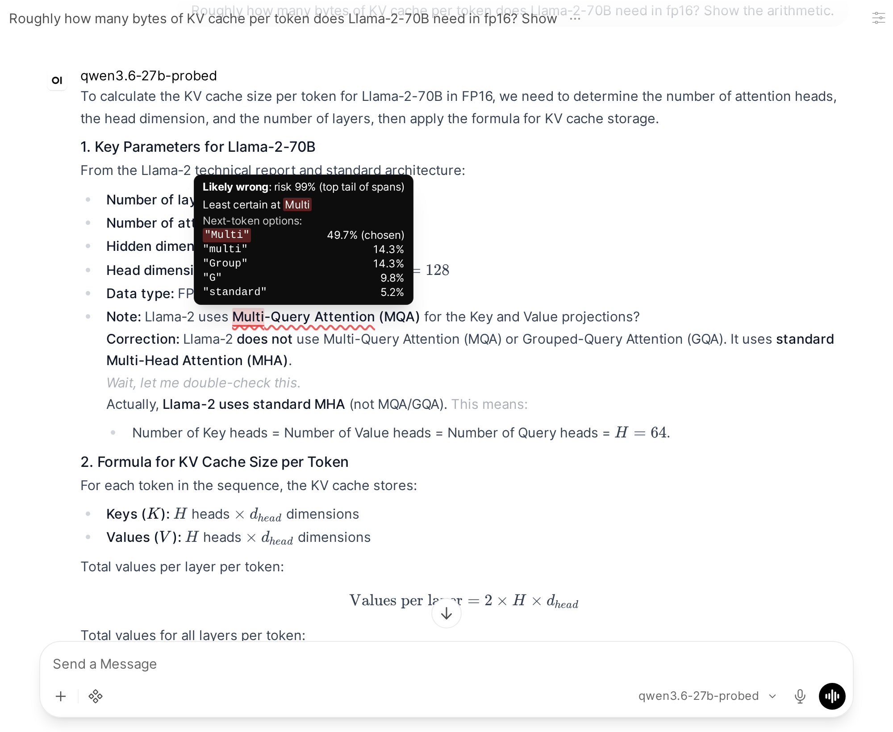
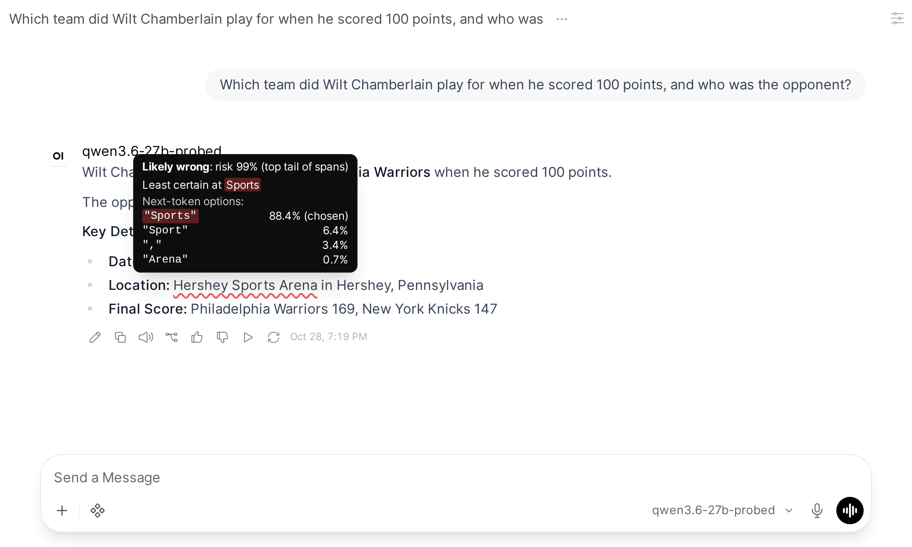
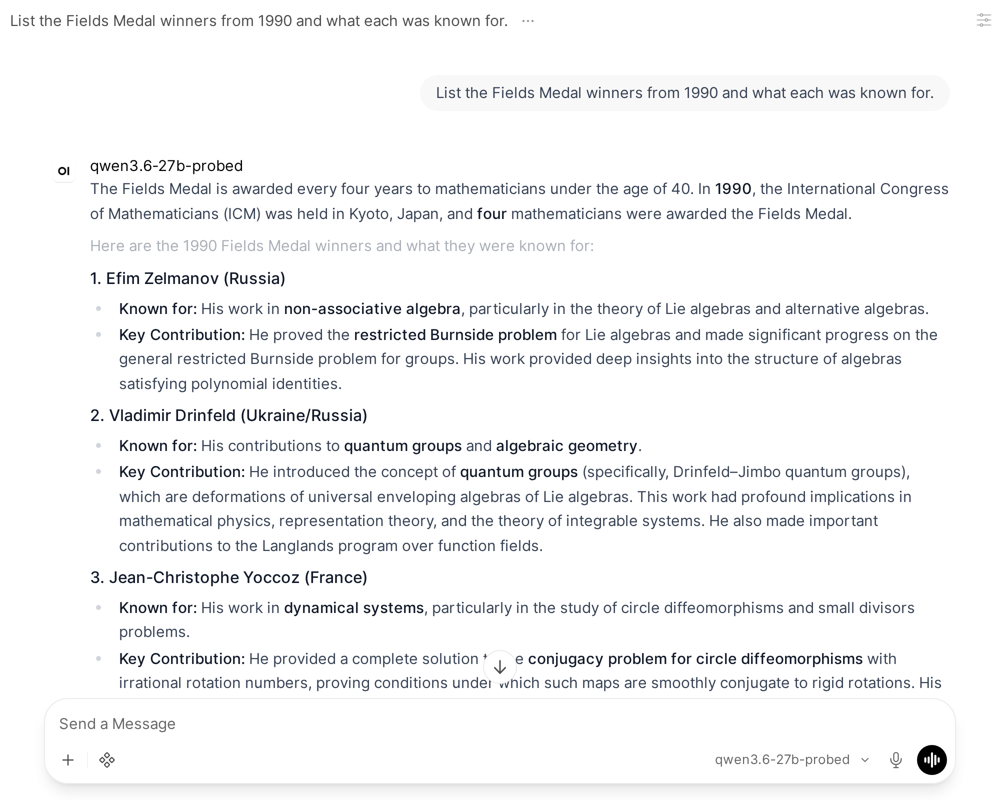
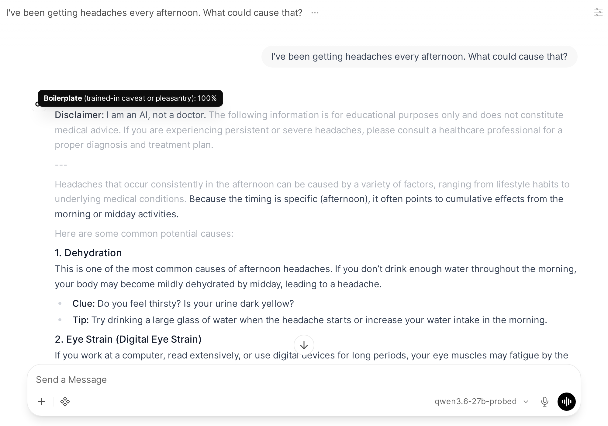

# llm_clearest_text: marking up LLM answers with probes on the model's own hidden states

Can a chat UI show you, inline, which parts of an answer the model itself is unsure of? This project
trains linear probes on an open model's hidden states, runs the model behind an OpenAI-compatible server
that tags its output as it streams, and renders the tags in a patched
[Open WebUI](https://github.com/open-webui/open-webui):

- a **red wavy underline** on names, dates and numbers the correctness probe thinks are wrong. Hovering shows the
  risk, the exact token the model was least sure of, and its other options at that token;
- **dimming** on boilerplate ("I am an AI, not a doctor…") and filler ("Here's a breakdown:") sentences.

**Bottom line: the probes are not accurate enough for this to be useful.** On held-out benchmarks they look
good (AUROC 0.93 for short trivia answers, 0.86–0.88 for one-sentence answers). In real long-form chat they
catch some wrong details but miss most fabrications. The worst misses are answers that are confidently wrong
from the first line, such as the wrong Fields Medal winners or a made-up citation, and those get no mark at
all. Meanwhile about a third of flags land on correct, well-known names. A UI that underlines a third of the errors
and leaves the rest clean teaches users to trust unmarked text, which is worse than no markup. The dimming
works better but sometimes hides the sentence that actually answers the question.

## Screenshots

All from Qwen3.6-27B (thinking off) with its own probes.

**A correct flag.** Gooden's 1985 ERA was 1.53, not 2.56. The tooltip shows the model's spread over the
last digit:



**The best case: the flag lands where the answer went wrong.** Llama-2-70B uses grouped-query attention.
The model was 50% "Multi", with "Group" at 14%, then argued itself into plain multi-head attention and
computed 2.5 MB per token instead of 320 KB. The final number is inside LaTeX, which the probe doesn't check:



**A false alarm.** Everything here is correct (Hershey Sports Arena, 169–147):



**A confident error with no flag at all.** Zelmanov and Yoccoz won in 1994. The 1990 medalists were
Drinfeld, Jones, Mori and Witten:



**Dimming.** The disclaimer is boilerplate, and "Here are some common potential causes:" is filler:



## Results

Probes were trained separately for each model, with the same recipe throughout:

| | Qwen2.5-1.5B | Qwen2.5-7B | Qwen3.6-27B |
|---|---|---|---|
| Trivia accuracy (short answers) | 34% | 55% | 72% |
| Correctness probe AUROC, short answers (best logprob baseline) | 0.894 (0.844) | 0.931 (0.855) | 0.933 (0.870) |
| Same probe, one-sentence answers: AUROC | 0.81 | 0.88 | 0.86 |
| … precision / recall at the UI threshold | 0.89 / 0.14 | 0.98 / 0.23 | 0.90 / 0.27 |
| Boilerplate probe AUROC / AP | 0.99 / 0.93 | 0.995 / 0.89 | 0.994 / 0.81 |
| Filler probe AUROC / AP | 0.97 / 0.87 | 0.97 / 0.87 | 0.97 / 0.85 |

These held-out numbers overstate usefulness, because the probe was trained and tested on short answers.
I hand-graded 25 long-form chat answers from Qwen3.6-27B (biographies, sports, history, plus three advice
questions), and later 13 technical ML questions with reference answers
([`results/qwen3.6-27b_grades.md`](results/qwen3.6-27b_grades.md)):

- **Precision about 70%:** roughly 33 flags were on real errors and 14 were false alarms.
- **Recall far lower:** whole fabricated claims went unflagged. Examples: the wrong Fields Medal winners, Henry
  Fielding's second wife, the first sub-4-minute mile in the US, Sydney Opera House history, and made-up citations.
- **Only 2 of 25 answers had flags that covered their errors.** Seven were mixed, six were confidently wrong
  with no flags, and five were correct but flagged.
- **An earlier, looser pass over the same 25 questions with Qwen2.5-7B** found 11 answers with missed
  errors, against 9 where the flags landed on real errors
  ([`results/qwen2.5-7b_screen.jsonl`](results/qwen2.5-7b_screen.jsonl)).

Why it falls short:

- **Training doesn't match use.** The probe learns "is this short trivia answer right" from the hidden state
  at its last token. In long-form prose, most spans in a bad answer score 0.85–0.98, so a top-5% cutoff marks
  few of them.
- **It misses fabrications made with confidence.** An answer that starts from a wrong premise (the 1994
  winners in place of the 1990 ones) carries no uncertainty for the probe to read.
- **Spans come from a regex.** Only capitalized names and numbers are checked. Lowercase claims ("lost the
  World Series") and anything inside LaTeX or code are never scored.
- **The hidden states can't tell rare from wrong.** Correct but uncommon names (Hershey Sports Arena,
  John Bozeman) look the same to the probe as wrong ones.

## How it works

1. **Correctness probe** (`probes/gen_trivia.py`, `train_correctness.py`): the model answers 8,000 TriviaQA
   questions. Each answer is labeled correct or incorrect by alias match, and a logistic-regression probe is
   fit on the hidden state at the answer's last token, choosing the best layer on validation.
2. **Style probes** (`gen_responses.py`, `label_style.py`, `train_style.py`): the model answers about 600
   everyday prompts (Dolly-15k plus advice questions that tend to draw caveats). Claude labels every sentence
   as boilerplate, filler or substantive, and sentence probes are fit on mean-pooled hidden states.
3. **Calibration** (`train_style.py`, `eval_prose_risk.py`): the risk threshold is the 95th percentile of
   span risk across everyday chat, checked against one-sentence TriviaQA answers.
4. **Server** (`server/probed_server.py`): an OpenAI-compatible server that decodes token by token, keeps
   the hidden states, and emits each completed sentence wrapped in tags:
   - `<probe-s>` marks a sentence;
   - `<probe>` marks a factual span;
   - `<probe-t>` marks the contested token inside a span.

   Each tag carries URL-encoded JSON. Models are served as `<name>-probed`, `<name>-probed-debug` (scores
   on every span) and `<name>-plain`.
5. **Frontend** (`webui/probe-rendering.patch`): a marked extension plus Svelte components that render the
   tags with marks the model can't produce itself (wavy underline, opacity, hover). The patch also strips
   the tags from copied text and text-to-speech.

## Running it

```bash
pip install -r requirements.txt

# Probes: about 1 GPU-hour for 7B, plus Claude labeling (needs ANTHROPIC_API_KEY). Or skip this and use the shipped probes in data/<model>/.
scripts/train_probes.sh Qwen/Qwen2.5-7B-Instruct             # local GPU
scripts/train_modal.sh Qwen/Qwen2.5-7B-Instruct L40S          # or on Modal

# Model server
scripts/run_server_cpu.sh --model Qwen/Qwen2.5-1.5B-Instruct --port 8100   # local
scripts/deploy_modal.sh Qwen/Qwen3.6-27B H100                              # or on Modal (writes .modal_url / .modal_api_key)

# Frontend: patched Open WebUI 0.12.4
git clone https://github.com/open-webui/open-webui vendor/open-webui
git -C vendor/open-webui checkout 33c1978d5bad52a31df75ea55143025dfad18d16
git -C vendor/open-webui apply ../../webui/probe-rendering.patch
(cd vendor/open-webui && npm ci && npm run build)
pip install open-webui==0.12.4                                 # backend; serves the patched build
OPEN_WEBUI=$(which open-webui) scripts/run_webui.sh            # http://127.0.0.1:8080, or scripts/run_webui_modal.sh for the Modal server
```

Qwen3.6 needs `flash-linear-attention` and an 80 GB GPU in bf16. With thinking off it loops under greedy
decoding, so use temperature 0.7 and top-p 0.8.

`scripts/screen_to_webui.py` runs a list of questions through the server and imports the annotated answers as
Open WebUI chats in a folder. `scripts/render_for_review.py` prints them as plain text with the flags
marked, for grading.

## Data

Probe weights for all three models are in `data/<model>/`. They're small `.npz` files with the layer,
weights, bias and threshold. The training data is on Hugging Face at
[robrenaud/llm-clearest-text-probes](https://huggingface.co/datasets/robrenaud/llm-clearest-text-probes): for each
model, the trivia answers with correctness labels and logprob baselines, the chat responses, and Claude's
sentence labels.

## Layout

| Path | Contents |
|---|---|
| `probes/` | data generation, labeling, training, evaluation; `segment.py` (sentence and span segmentation, shared by training and serving) |
| `server/` | `probed_server.py`; `modal_app.py` (serving) and `modal_train.py` (training pipeline) for Modal |
| `webui/probe-rendering.patch` | Open WebUI frontend changes |
| `scripts/` | deploy, train, run, screening, screenshots |
| `prompts/` | screening questions, a graded technical question set, the UI-review brief used with Claude in Chrome |
| `results/` | annotated screening answers and hand grades |

## Related work

- [obalcells/hallucination-probes](https://github.com/obalcells/hallucination-probes): token-level
  hallucination probes trained on long-form entity annotations. This is the more principled version of the
  correctness probe here, and the natural next thing to try.
- [Open WebUI](https://github.com/open-webui/open-webui), the frontend this patches.
